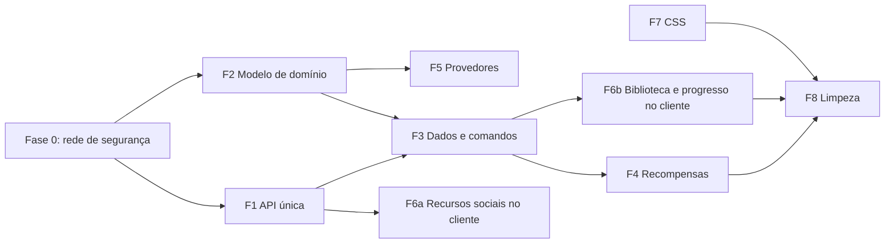

# Lume — plano de refatoração (01/11/2026)

> **Estado: aprovado para execução, nada implementado.** A responsável decidiu seguir com todas as frentes
> abaixo. Este documento descreve o destino da arquitetura e a ordem para chegar lá; ele não muda regras de
> produto. Pontuação continua em [Gamificação](GAMIFICACAO.md), lacunas de produto em
> [O que falta implementar](IMPLEMENTACAO.md) e importação em [Importação](IMPORTACAO.md). Ao concluir uma
> etapa, marque-a aqui e atualize os documentos indicados nela.

O Lume mudou de propósito várias vezes (organizador individual → plataforma social de estudos com XP validado,
ranking, mensagens, extensão e aplicativo de desktop). O código acompanhou por acréscimo: cada recurso novo
foi encaixado sobre a estrutura do protótipo. O resultado são oito frentes que pedem reestruturação, não só
reescrita, porque a forma atual encarece ou impede as próximas funcionalidades.

---

## Sumário

| Frente | Problema central | Destrava (ver [Implementação](IMPLEMENTACAO.md)) | Tamanho | Depende de |
| --- | --- | --- | --- | --- |
| [F1 — API única](#f1--api-única-com-adaptadores) | Node e Worker repetem toda a camada HTTP | C2, C3, S2 e qualquer rota nova | M | — |
| [F2 — Modelo de domínio único](#f2--modelo-de-domínio-único) | Três registros de progresso e dois modelos de curso | B1, B3, G5 | G | — |
| [F3 — Dados no servidor e comandos](#f3--dados-normalizados-no-servidor-e-comandos) | O documento do navegador é a fonte da verdade, inclusive do XP | I6, C4, G1 | G | F1, F2 |
| [F4 — Motor de recompensas](#f4--motor-de-recompensas) | XP escrito à mão por tipo e empurrado pelo cliente | G2, G3, G4, G5, S5 | M | F3 |
| [F5 — Importação por provedor](#f5--importação-por-provedor) | Extração genérica; provedor é só rótulo | I1, I2, I6 | G | F2 (identidade) |
| [F6 — Cliente por funcionalidade](#f6--cliente-por-funcionalidade) | Um hook e um setter de estado inteiro para tudo | S1, V2 e telas novas | G | F6a: —; F6b: F3 |
| [F7 — CSS por componente](#f7--css-por-componente-sobre-tokens) | 125 KB em camadas sobrepostas e cinco folhas mortas | V1, D1, D4 | M | — |
| [F8 — Limpeza](#f8--limpeza-e-reescritas-pontuais) | Código legado, exportações mortas, documentos sobrepostos | D2, D3 | P | F2–F4 |

Tamanho é relativo (P, M, G), não estimativa de prazo.



---

## Princípios para todas as frentes

1. **Preservar dados.** Nenhuma etapa apaga progresso, converte preparação em aula concluída ou recalcula XP já
   concedido. Toda conversão é uma função pura testada com estados reais anonimizados antes de rodar em conta.
   O documento antigo de cada conta fica guardado, só para leitura, até a responsável autorizar a remoção.
2. **Estrangulamento, não big bang.** Cada etapa termina com o site funcionando, `npm test`, `npm run build` e
   `npm run test:e2e` verdes. O código novo convive com o antigo atrás da mesma rota até a troca.
3. **Clientes antigos existem.** O service worker usa stale-while-revalidate: quem já visitou roda a versão
   anterior por uma visita, e a extensão publicada pode estar defasada. Rotas e formatos antigos continuam
   aceitos por pelo menos um ciclo, com resposta explícita quando não puderem mais ser atendidos.
4. **Migrações SQL só com número novo** (`0011_…` em diante). Nunca editar migração aplicada.
5. **Sem publicação implícita.** Nenhuma etapa inclui deploy, migração remota no D1 ou release do Companion
   sem pedido explícito, como manda o `AGENTS.md`.
6. **Documentação acompanha.** Cada etapa lista os documentos que precisa atualizar; a matriz de
   [Continuidade](CONTINUIDADE.md) e as lacunas de [Implementação](IMPLEMENTACAO.md) mudam junto com o código.

---

## Fase 0 — Rede de segurança

Antes de mexer em estrutura, fixar o comportamento atual para detectar regressões.

- [ ] **Fixtures de estado.** Reunir em `tests/fixtures/states/` documentos `lume.prototype.v1` com formato real
      e dados anonimizados: conta nova, conta com histórico legado (5/10 XP e preparações), curso importado com
      `structure`, curso com slides, tarefas com e sem vínculo, sessão ativa, exemplo sem progresso, backup antigo.
- [ ] **Testes de contrato da API.** `api-contract.test.js`: para cada rota `/api/*`, status, formato do corpo
      e códigos de erro atuais, executados contra o servidor Node em processo. Servem de referência para F1 e F3.
- [ ] **Testes dourados de XP.** Para cada fixture, a lista de `xp_events` que `xp.js` concede hoje. F4 tem de
      reproduzir exatamente as mesmas chaves (`event_key`) e valores.
- [ ] Incluir os arquivos novos no script `test` do `package.json`.

**Pronto quando:** os três conjuntos rodam no CI e descrevem o comportamento atual sem alterá-lo.

---

## F1 — API única com adaptadores

### Diagnóstico

- `server.js` (905 linhas) e `worker.js` (799 linhas) reimplementam roteamento, cadastro, login, sessão,
  limite de tentativas, redefinição de senha, perfil de amigos, checagem de origem, leitura de corpo e
  conversão de erro. Só a lógica de domínio (`auth.js`, `xp.js`, `messages.js`…) é compartilhada.
- A conversão de erro é uma cadeia de dez `instanceof` repetida nos dois arquivos (`server.js:879`,
  `worker.js:757`), uma por classe de erro de módulo, quase todas idênticas (`XpError`, `MessagesError`,
  `FriendsError`…).
- Os dois já divergem em detalhes: o Worker declara `MAX_STATE_BYTES = 256 KB` sem usá-lo (o limite efetivo é o
  de 320 KB em `state.js`), os limites de tentativas por rota são diferentes (20 × 10 no Desktop e nos convites,
  30 × 10 na importação) e o envio de imagem de perfil sem conta é aceito só no Node.
- O perfil de amigos (`server.js:611`) monta SQL dentro do servidor, fora de um módulo compartilhado.
- Os e2e sobem `node server.js` (`playwright.config.js`) e os testes unitários usam `node:sqlite`. O Worker, que
  é o que está publicado, não é exercitado por nenhum teste.

### Arquitetura alvo

```
api/
  app.js              createApp({ db, media, email, env, clock, log }) → { fetch(request) }
  router.js           tabela de rotas: método, caminho, auth, origem, limite de corpo, handler
  errors.js           AppError(message, { code, status, field }) — substitui as classes por módulo
  http.js             json(), readJson(request, limit), readBytes(), cookies
  middleware/
    session.js        resolve a conta pelo cookie (hoje currentUser duplicado)
    origin.js         sameOrigin
    rate-limit.js     tentativas por chave, sobre o adaptador de banco
  routes/
    account.js        register, login, logout, me, password/*
    state.js  import.js  github.js  companion.js  friends.js  profile.js
    media.js  xp.js  messages.js  collaboration.js
  adapters/
    sqlite.js         node:sqlite → { run, first, all, batch }
    d1.js             D1 → { run, first, all, batch }
    node-http.js      IncomingMessage → Request; Response → ServerResponse
    fs-media.js       hoje localMediaBucket em server.js
    r2-media.js       hoje r2BucketAdapter em media.js
server.js             Node: abre o banco, aplica migrações, serve dist/, delega /api/* a app.fetch
worker.js             Cloudflare: ASSETS para estáticos, app.fetch para /api/*
```

Cada rota declara o que exige, em vez de repetir checagens:

```js
route('POST', '/api/xp/complete', { auth: true, origin: true, body: 8 * 1024 }, ({ user, body, db }) =>
  grantStep(db, user.id, body));
```

O adaptador ganha `batch(statements)`: D1 não tem transação interativa, então F3 e F4 dependem de gravar
vários comandos de uma vez. No Node, `batch` envolve as instruções em `BEGIN`/`COMMIT`.

### Etapas

1. [ ] Criar `api/errors.js`, `api/http.js` e os adaptadores de banco (`companionDb()` em `server.js:421` e
       `dbAdapterFor()` no Worker viram `adapters/sqlite.js` e `adapters/d1.js`, com `batch`).
2. [ ] Fazer os módulos de domínio lançarem `AppError` (ou subclasses que herdam dela) e trocar as duas cadeias
       de `instanceof` por um único tratamento em `app.js`.
3. [ ] Mover as rotas de conta (cadastro, login, saída, recuperação) para `api/routes/account.js`, usando só o
       adaptador. Hoje o Node usa `prepare()` síncrono direto; passa a usar `db.first`/`db.run`.
4. [ ] Mover as demais rotas, uma família por vez, conferindo os testes de contrato da Fase 0 a cada passo.
5. [ ] Unificar constantes (limites de corpo, de estado, de tentativas) em `api/config.js`, lidas do `env`
       com os mesmos nomes nos dois ambientes. Manter os nomes antigos (`LUME_SHOW_RESET_LINK`,
       `LUME_ATTEMPT_LIMIT`) como apelidos por um ciclo e documentar a troca.
6. [ ] Reduzir `worker.js` e `server.js` a adaptadores. Nenhuma regra de rota fica neles.
7. [ ] Rodar os testes de contrato também contra o adaptador D1 (Miniflare, que já vem com o `wrangler`) para
       que o código publicado seja testado.

### Pronto quando

- `worker.js` e `server.js` não contêm nenhuma rota; uma rota nova é escrita uma vez.
- Há uma única classe de erro e um único conjunto de limites.
- Testes de contrato passam com SQLite e com D1; e2e verdes.

### Documentos

`AGENTS.md` (seção "A API existe duas vezes", armadilhas de configuração), [Release](RELEASE.md) se o CI ganhar
o passo com Miniflare.

---

## F2 — Modelo de domínio único

### Diagnóstico

- **Progresso em seis lugares:** `completed` (lista de ids), `history` (formato legado com 0, 5 ou 10 XP e
  entradas de preparação), `studyLog` (importação, integração e manual), `studySessions`, `tasks` (com XP próprio
  no navegador) e, no servidor, `xp_events`. `weekCount` soma três deles (`public/domain.js:511`).
- **Curso com dois modelos:** `steps` (lista plana) e `structure` (disciplina → módulo → aula). `steps` é derivado
  de `structure` na importação (`public/import-domain.js:355`) e os dois precisam ficar coerentes à mão.
- **Dois níveis:** o saldo legado (`levelInfo`, `totalXP`) ainda aparece em `Shell.jsx` e `Personal.jsx` ao lado
  do nível do servidor.
- **Validação tudo-ou-nada:** se um único curso, etapa ou entrada de histórico falhar, `restoreState`
  (`public/domain.js:660`) devolve o estado inicial vazio. O documento tem `version: 1` fixo e nenhuma migração
  de formato.

### Modelo alvo

| Entidade | Campos principais | Observações |
| --- | --- | --- |
| `Material` | `id`, `kind` (curso, leitura, projeto, aula avulsa, slides), `title`, `url`, `art`, `paused`, `planning`, `resume`, `source` | `source` guarda provedor, `externalId`, extração, capacidades e avisos (F5) |
| `Unit` | `id`, `materialId`, `parentId`, `kind` (disciplina, módulo, aula, etapa, slide), `title`, `order`, `externalId`, `url`, `duration`, `removedFromSource` | Árvore genérica: material criado à mão tem etapas na raiz; importado tem disciplina → módulo → aula |
| `ProgressEvent` | `id`, `unitId`, `materialId`, `type` (`completion`, `reversal`, `preparation`), `origin` (`manual`, `import`, `integration`, `legacy`), `historical`, `at` | Só cresce. Reverter é um evento novo, não apagar |
| `StudySession` | `id`, `materialId`, `unitId`, `startedAt`, `endedAt`, `pauses` | Declaração de tempo, nunca prova de atividade |
| `Task` | `id`, `title`, `unitId?`, `materialId?`, `dueDate`, `priority`, `subtasks`, `doneAt` | XP depende da decisão G4 |
| `Preferences` | tema, paleta, texto, meta semanal, compartilhamento, onboarding | Fica no documento de interface |

Tudo o mais é **derivado**: conjunto de unidades concluídas, progresso do material, contagem da semana, próxima
aula, saldo legado (só para exibição na prévia, enquanto existir).

### Regras de conversão do documento v1 → v2

- **Ids preservados.** O `id` de cada etapa vira o `id` da `Unit`. Isso mantém válidos `xp_events.step_id`, as
  chaves `event_key` já gravadas, os vínculos de tarefas e as referências em mensagens.
- `structure` vira a árvore; `steps` sem estrutura vira unidades `kind: 'etapa'` na raiz.
- `completed` + `history` + `studyLog` viram `ProgressEvent`:
  - entrada de `history` com `preparation: true` → `type: 'preparation'`, nunca `completion`;
  - entrada de `history` com XP 5 ou 10 → `origin: 'legacy'`, mantendo o valor antigo em `meta`;
  - entrada de `studyLog` com `origin: 'import'` → `historical: true`;
  - id em `completed` sem evento correspondente → `completion` com `origin: 'legacy'` e data desconhecida
    (não entra em nenhuma política nova).
- Item inválido é descartado **sozinho** e registrado em `conversionNotes`, nunca derruba o documento inteiro.
- O documento v1 original é guardado sem alteração (`lume.prototype.v1.backup` no navegador; coluna própria no
  servidor em F3).

### Etapas

1. [ ] Criar `public/model/` com as entidades, as funções derivadas e os testes. Nada da interface muda ainda.
2. [ ] Escrever `convertV1toV2(state)` pura e testá-la com todas as fixtures da Fase 0, conferindo contagens
       (unidades, conclusões, preparações, XP legado) antes e depois.
3. [ ] Escrever `restoreState` v2 com validação por item e um leitor v1 que converte na carga.
4. [ ] Adaptar `backup-domain.js` e `merge-domain.js` para v2, mantendo a leitura de backups v1.
5. [ ] Trocar as telas para os seletores derivados (`completedUnits`, `materialProgress`, `nextUnit`), uma tela por
       vez. O critério de próxima aula passa a ser o do roteiro (resolve B4: `nextMission` segue a ordem da
       biblioteca em `StudyDialog.jsx` e `Personal.jsx`).
6. [ ] Remover `steps` como campo armazenado e as leituras diretas de `completed`/`history`/`studyLog`.

### Pronto quando

- Existe um único registro de progresso e um único modelo de material; `steps` e `structure` deixaram de
  coexistir.
- Uma fixture com um item corrompido carrega todo o resto.
- Bônus por disciplina (G5) e desfazer progresso de material manual (B1) são implementáveis sem tocar em mais de
  um registro.

### Documentos

[Continuidade](CONTINUIDADE.md), [Gamificação](GAMIFICACAO.md) (onde fala do saldo legado), `AGENTS.md` (lista de
módulos de domínio).

---

## F3 — Dados normalizados no servidor e comandos

### Diagnóstico

- Todo o progresso de uma conta é um JSON único em `user_state`, gravado pelo navegador inteiro a cada mudança
  (debounce de 900 ms em `useLume.js`; a sessão ativa toca o estado a cada 60 s em `Study.jsx:151`).
- **O XP não é validado de verdade pelo servidor.** `grantStep` (`xp.js:292`) confere `state.completed` e a data
  de conclusão lidas do documento que o próprio cliente escreveu. Quem altera o JSON obtém XP e sobe no ranking.
- XP (`xp.js:118`), colaboração (`collaboration.js:56`), desktop (`companion.js:168`) e perfil (`server.js:626`)
  relêem e interpretam o documento inteiro a cada requisição.
- O limite de 600 aulas e 320 KB (I6) é consequência direta desse formato.
- Conflitos entre dispositivos exigem mesclar o documento inteiro por heurística (`merge-domain.js`,
  `backup-domain.js`); o cliente tenta três vezes e desiste.

### Arquitetura alvo

**Tabelas** (migração `0011_library.sql` e seguintes):

```
materials        (id, user_id, kind, title, url, art, paused, planning, resume, source_json, created_at, updated_at, deleted_at)
units            (id, user_id, material_id, parent_id, kind, title, position, external_id, url, duration, removed_from_source)
progress_events  (id, user_id, unit_id, material_id, type, origin, historical, at, command_id, meta)
study_sessions   (id, user_id, material_id, unit_id, started_at, ended_at, declared_seconds, pauses_json)
tasks            (id, user_id, title, unit_id, material_id, due_date, priority, subtasks_json, done_at)
user_documents   (user_id, preferences_json, onboarding_json, revision, updated_at)
commands_applied (user_id, command_id, applied_at, result_json)   -- idempotência
state_migrations (user_id, source_revision, migrated_at, notes_json)
```

Índices por `(user_id, material_id)` e `(user_id, at)`. `user_state` continua existindo, só para leitura, com o
documento v1 original.

**Comandos em vez de documento.** O cliente envia uma lista de comandos, cada um com id próprio:

```
POST /api/sync   { commands: [{ id, type, payload, at }], since: cursor }
→ { applied: [{ id, ok, result | error }], changes: [...], cursor }
GET  /api/sync?since=cursor → { changes, cursor }
```

Tipos iniciais: `material.create|update|delete`, `units.replace` (importação), `progress.complete`,
`progress.revert`, `session.start|pause|end`, `task.create|update|complete|reopen`, `preferences.update`.
O servidor valida cada comando com as mesmas funções de `public/model/` (F2), grava as linhas e avalia as
recompensas (F4) no mesmo `batch`. Repetir um comando com o mesmo `id` devolve o resultado gravado em
`commands_applied`.

**Cliente.** Guarda o modelo v2 localmente e uma **fila de saída** de comandos. Aplica cada comando de forma
otimista, envia a fila quando há conta e rede, e incorpora `changes` de outros dispositivos. Como os eventos só
crescem e têm chave, a mesclagem do documento inteiro desaparece. A prévia sem conta usa os mesmos comandos
sem enviar a fila; ao entrar na conta, a fila acumulada é oferecida para envio (resolve C4).

### Migração das contas existentes

- **Conversão preguiçosa e idempotente:** na primeira chamada a `/api/sync` de uma conta sem linha em
  `state_migrations`, o servidor converte `user_state` com `convertV1toV2` e grava as tabelas num `batch`.
- **Risco de CPU no Worker gratuito (10 ms).** Um documento de 256 KB pode não caber numa requisição. Medir com
  as fixtures maiores; se não couber, a conversão é feita **no cliente** (que já tem o código) e enviada como
  comandos `import.legacy` em blocos, com o servidor conferindo contagens.
- Clientes antigos: `PUT /api/state` passa a aceitar só preferências; uma gravação de progresso recebe `409` com
  `code: 'client_outdated'` e a interface pede para recarregar. Ver decisões pendentes.

### Etapas

1. [ ] Migração SQL das tabelas novas.
2. [ ] Módulo `library.js` (servidor) com leitura e gravação por comando, testado sobre SQLite e D1.
3. [ ] Rota `/api/sync` e conversão preguiçosa, com testes de idempotência e de concorrência (dois
       dispositivos enviando o mesmo comando e comandos conflitantes).
4. [ ] Cliente: armazenamento local v2, fila de saída e reconciliação. Avaliar IndexedDB: `localStorage` tem
       cerca de 5 MB e é síncrono, o que limita cursos grandes.
5. [ ] Perfil, desktop e colaboração passam a ler as tabelas, não o documento.
6. [ ] Trocar o fluxo da interface para `/api/sync`; `PUT /api/state` fica restrito.
7. [ ] Exportação e importação de backup passam a gerar/aceitar v2 (mantendo leitura de v1).
8. [ ] Reavaliar os limites de I6 com o novo formato (limite por material, não por conta).

### Pronto quando

- Nenhuma rota de XP, perfil, desktop ou colaboração lê `user_state`.
- Editar o armazenamento local não concede XP: só um comando aceito pelo servidor gera evento.
- Um curso com milhares de aulas importa sem passar por um limite global de bytes.
- e2e cobre dois dispositivos com comandos concorrentes (substitui `state-conflict.spec.js`).

### Documentos

`AGENTS.md` (seção Estado), [Continuidade](CONTINUIDADE.md), [Implementação](IMPLEMENTACAO.md) (I6, C4, G1),
[Companheiro](COMPANHEIRO.md) se o formato de `/api/companion/study` mudar.

---

## F4 — Motor de recompensas

### Diagnóstico

- `xp.js` (720 linhas) tem uma função por tipo (`grantStep`, `grantBonus`, `grantSlide`, `recordTimeSession`) e
  conquistas calculadas por código específico (`achievementForStep`, `achievementForBonus`).
- O cliente encontra o que ainda não foi pontuado (`collectCompletionCandidates` em `xp-policy.js`), envia rota a
  rota e lembra o que já mandou em `localStorage` (`lume.xp.sent.v1`).
- Próximos itens — cargos e desbloqueios (G2), conquistas escolhidas (G3), XP de tarefas (G4), bônus de
  disciplina (G5), contribuição em colaboração (S5) — seriam mais funções e mais um laço no cliente.

### Arquitetura alvo

- Cada comando aceito em F3 gera **eventos de domínio** (`unit.completed`, `material.completed`,
  `discipline.completed`, `session.ended`, `task.completed`…).
- `rewards/rules.js` lista **regras declarativas**:

  ```js
  rule({
    id: 'lesson-completion',
    on: 'unit.completed',
    when: (ctx) => ctx.unit.kind === 'aula' && isEligible(ctx.material) && !ctx.event.historical,
    key: (ctx) => stepEventKey(kindFor(ctx.material), ctx.material.id, ctx.unit.id),
    xp: (ctx) => XP_VALUES[kindFor(ctx.material)],
    achievement: (ctx) => null,
  });
  ```

  Valores, tetos e marcos continuam em `public/xp-policy.js`.
- O motor roda **no servidor**, dentro do mesmo `batch` do comando, e grava em `xp_events` com o mesmo formato de
  `event_key` de hoje. Repetir o comando não duplica XP.
- Nível, conquistas, cargos e desbloqueios são **projeções** do livro: calculadas a partir de `xp_events` e
  `progress_events`, com tabela própria só quando precisam ser concedidas uma vez (`user_unlocks` para G2).
- O tempo declarado mantém o acumulador atual (`xp_time_sessions`), agora alimentado por `session.ended`.

### Etapas

1. [ ] Extrair as regras atuais para o formato declarativo sem mudar comportamento; os testes dourados da Fase 0
       precisam continuar idênticos.
2. [ ] Ligar o motor aos comandos de F3.
3. [ ] Remover `collectCompletionCandidates`, as rotas `/api/xp/complete|bonus|slides` como entrada do cliente
       (ficam só leitura e ajuste) e `lume.xp.sent.v1`.
4. [ ] Implementar as regras novas conforme as decisões da responsável: G5, G4, G2 (com `user_unlocks`), S5.
5. [ ] Retirar o saldo legado da exibição (ver decisões pendentes).

### Pronto quando

- Uma regra nova é uma entrada em `rules.js` com teste, sem rota nova e sem código no cliente.
- Testes dourados idênticos; teste de concorrência prova uma única concessão.

### Documentos

[Gamificação](GAMIFICACAO.md), `AGENTS.md` (seção XP validado no servidor), [Evolução](EVOLUCAO.md) §4.

---

## F5 — Importação por provedor

### Diagnóstico

Hoje a extração é **genérica**, e o provedor serve quase só como rótulo:

| Caminho | Onde | Como lê | Uso do provedor |
| --- | --- | --- | --- |
| Link público | `extractFromHtml`, `import-server.js:363` | schema.org; senão, títulos e listas filtrados por regex (`LESSON_LIKE`, `NAV_NOISE`, `ITEM_NOISE`) | Avisos para Gran, Estratégia e Udemy; tirar o nome do site do título |
| Página copiada | `analyzeSnapshot`/`snapshotOutline`, `import-server.js:657` | A mesma heurística, mais tolerante | Nenhum |
| Extensão | `run`, `extension/capture.js:639` | Varre o DOM procurando linhas com cara de aula | Nenhum, **exceto Gran**: `readGranApi` usa as rotas JSON da página e volta ao DOM se falhar |

Consequências:

- **Identidade por título.** O id de aula é hash de provedor, URL, disciplina, módulo e título
  (`normalizePayload`, `import-domain.js:192`). Renomear uma aula na plataforma cria outra aula e o progresso se
  perde na reimportação. O Gran entrega ids estáveis (`item.id`, `id_video`), que são descartados.
- **Conclusão adivinhada.** `completedTitlesFromHtml` e `isDone` procuram palavras como "concluído", "done" ou
  "100%" e classes como `completed`, depois comparam por título.
- **Capacidades fixas.** `providerCapabilities` (`import-domain.js:97`) responde "não acessa a conta" e "não
  consulta progresso" até para o Gran lido pela API, contrariando a regra de declarar capacidades reais.
- **Lista de plataformas em quatro lugares:** `PROVIDERS`, `PROVIDER_HOSTS` e `PLATFORM_NAME` (`capture.js`) e a
  lista de `tidyTitle`.
- **Sem teste por plataforma:** link testado com HTML sintético; extensão com páginas de exemplo.

### Princípio novo

**Cada provedor tem uma implementação própria**, responsável por ler a grade, dar identidade estável às
unidades e detectar conclusão. A leitura genérica deixa de ser o caminho padrão:

- Plataforma **conhecida com adaptador** → usa o adaptador.
- Plataforma **conhecida sem adaptador** → mensagem de "ainda não suportado" e oferta de texto colado; não tenta
  adivinhar.
- Plataforma **desconhecida** → provedor `generic` explícito, confiança baixa, **sem leitura de conclusão**.
- Texto colado e organização por IA continuam como provedor `text`.

### Contrato do adaptador

```js
// providers/grancursos.js
export default defineProvider({
  id: 'grancursos',
  label: 'Gran Cursos Online',
  hosts: ['grancursosonline.com.br'],
  art: 'nature',
  help: 'Abra o curso com a sua conta e use a extensão do Lume.',
  capabilities: {
    syllabus: 'full',           // full | partial | none
    progress: 'lesson-flags',   // none | lesson-flags | api
    resume: false,
    requiresLogin: true,
  },
  identify(url) {               // → { courseExternalId, canonicalUrl } ou null
    const code = /^\/aluno\/curso\/(?:video\/)?codigo\/([^/]+)/i.exec(url.pathname)?.[1];
    return code ? { courseExternalId: code, canonicalUrl: `${url.origin}/aluno/curso/codigo/${code}` } : null;
  },
  readers: {
    page: readFromLoggedPage,   // extensão, na página aberta com a conta (rotas JSON do Gran)
    // public: readFromPublicPage — servidor, só HTML público
    // snapshot: readFromCopiedHtml — página copiada pela pessoa
  },
});
```

Todo leitor devolve o mesmo formato: disciplinas → módulos → aulas, **cada nível com `externalId`**, mais
`completed` só quando o adaptador declara `progress` diferente de `none`. Utilitários comuns (busca com proteção
contra rede interna, `textOf`, `toSeconds`, limite de concorrência) ficam em `providers/kit/`, como ferramentas,
não como parser.

### Identidade estável e migração

- Unidade nova: `id = hash(provider | courseExternalId | unitExternalId)`.
- Unidade já importada (id por título): na primeira reimportação com adaptador, casar pelo caminho de títulos
  (disciplina, módulo, aula) e **gravar o `externalId` na unidade existente, mantendo o id antigo**. Progresso,
  XP e vínculos continuam intactos. O que não casar entra como novo e o antigo fica `removedFromSource`, como
  hoje.

### Onde cada leitor roda

- `page` roda na extensão; `public` e `snapshot`, no servidor (`/api/import/analyze`).
- **A extensão passa a ter build.** `capture.js` hoje é script clássico sem `import`; para compartilhar os
  adaptadores, `extension/src/` é empacotado (por exemplo, com esbuild) em `dist-extension/` pelo
  `scripts/package-extension.mjs` que já existe. Permissões do manifest não mudam (`activeTab`).
- O formato entregue ao Lume por `postMessage` continua aceito na versão antiga por um ciclo, porque a extensão
  publicada pode estar defasada.

### Ordem dos provedores

1. **Gran** — já tem leitura pela API conferida com conta real (01/11/2026, 31 disciplinas, 427 aulas).
2. **Coursera** e **Alura** — páginas públicas conferidas em 31/10.
3. **Udemy** — o servidor recebe 403; só pela extensão.
4. **Estratégia** — exige login; pela extensão.
5. **Rocketseat**, **DIO**, **Hotmart** — conforme demanda.

Cada provedor só é marcado como suportado com: fixture gravada de página real (anonimizada) em
`tests/fixtures/providers/<id>/`, teste do leitor contra ela, conferência manual datada em
[Importação](IMPORTACAO.md) e capacidades declaradas.

### Etapas

1. [ ] `providers/registry.js`, `defineProvider` e `providers/kit/`; `PROVIDERS` passa a ser derivado do registro.
2. [ ] Adaptador do Gran a partir de `readGranApi`, com `externalId` em todos os níveis.
3. [ ] Provedores `generic` (heurística atual, sem conclusão) e `text` (texto colado e IA).
4. [ ] Build da extensão e remoção de `PROVIDER_HOSTS`/`PLATFORM_NAME` duplicados.
5. [ ] `providerCapabilities` lê o adaptador; a revisão da importação mostra o que cada plataforma realmente faz.
6. [ ] Migração de identidade na reimportação, com teste usando curso importado por título.
7. [ ] Demais provedores, um por vez, na ordem acima.

### Pronto quando

- Nenhuma lista de domínios fora do registro.
- Reimportar um curso com aula renomeada preserva o progresso dela.
- Toda plataforma suportada tem teste com fixture real e capacidades corretas na interface.

### Documentos

[Importação](IMPORTACAO.md) (seções de plataformas e extensão), `extension/LEIAME.md`, `AGENTS.md` (seção
Extensão: "sem build" deixa de valer), [Implementação](IMPLEMENTACAO.md) I1, I2, I6.

---

## F6 — Cliente por funcionalidade

### Diagnóstico

- `useLume` (294 linhas) junta conta, prévia, sincronização, envio de XP e mesclagem.
- `App.jsx` entrega `state` e `update` (substitui o estado inteiro) a todas as telas (`App.jsx:111`); o
  conteúdo de três modais está numa única linha de 1.456 caracteres.
- Recursos do servidor são buscados tela a tela com `api()` e `setInterval` próprios (menu e Mensagens a cada
  45 s, Companion a cada 20 s), sem cache nem deduplicação.
- Rotas são um `switch` com leitura de parâmetros espalhada; `SectionTabs.jsx` repete a lista de telas.
- Componentes muito grandes: `Personal.jsx` e `ImportCourse.jsx` (31 KB cada), `Profile.jsx`, `StudyDialog.jsx`,
  `Study.jsx`, `Onboarding.jsx` (com 18 linhas acima de 300 caracteres).

### Arquitetura alvo

```
src/
  app/
    routes.js         tabela: hash, seção, componente, leitura de parâmetros; SectionTabs deriva daqui
    App.jsx           só casca, roteamento e modais registrados
  features/
    account/          sessão, prévia, entrada e saída
    library/          materiais, importação, editor, slides
    progress/         conclusões, sessão de estudo, histórico
    plan/             cronograma, tarefas, roteiro
    social/           amigos, perfil, mensagens, colaboração, ranking
    desktop/          Companion e atualização
    settings/
      (cada uma: store.js | actions.js | selectors.js | components/)
  lib/
    api.js            cliente HTTP
    resources.js      cache de recursos do servidor com polling compartilhado
    sync.js           fila de saída de F3
```

### Etapas

**F6a — independe de F2/F3, pode começar já:**

1. [ ] Tabela de rotas e `SectionTabs` derivado dela.
2. [ ] Camada de recursos com cache e polling compartilhado; migrar Amigos, Mensagens, Ranking, Colaboração,
       Companion e o contador de não lidas.
3. [ ] Tirar os modais de `App.jsx` para componentes registrados.

**F6b — depois de F3:**

4. [ ] Separar `useLume` em `account`, `sync` e stores por funcionalidade sobre o modelo v2.
5. [ ] Telas recebem ações (`completeUnit`, `pauseMaterial`) em vez de `update(previous => …)`.
6. [ ] Quebrar os componentes grandes em subcomponentes por funcionalidade.

### Pronto quando

- Nenhuma tela recebe `update` do estado inteiro.
- Cada recurso do servidor é buscado em um único lugar, com um único intervalo.
- Uma tela nova é uma pasta em `features/` e uma linha em `routes.js`.

### Documentos

`AGENTS.md` (seção SPA em uma única página Astro).

---

## F7 — CSS por componente sobre tokens

### Diagnóstico

- `public/lume.css` tem 125 KB e 6.111 linhas; as camadas novas (Plano, Redesign Moderno) sobrescrevem regras
  antigas no fim do arquivo.
- `entry.css`, `neurofocus.css`, `styles.css`, `stitch.css` e `motion.css` (cerca de 120 KB) não são carregados
  por nenhuma página e continuam publicados.
- Comentários com acentuação corrompida a partir de `lume.css:4400`.
- `@fontsource-variable/fraunces` está em `package.json` sem uso.
- O redesenho das oito telas restantes (V1) acrescentaria mais uma camada.

### Arquitetura alvo

```
src/styles/
  tokens.css        paletas (Azul, Roxo), temas e funções de cor — o topo atual de lume.css
  base.css          reset, tipografia, controles, utilitários
  shader.css        regras do Paper Shaders predeclaradas para a CSP (lume.css:234), sempre globais
src/features/<área>/components/*.css   importados pelo próprio componente
```

O Vite gera nomes com hash, então o `?v=` manual em `index.astro` deixa de ser necessário. A CSP não muda:
folhas externas já são permitidas por `'self'`; `scripts/headers.mjs` continua cuidando só do inline.

### Etapas

1. [ ] Remover as cinco folhas sem uso e a dependência `fraunces`; corrigir a codificação dos comentários.
2. [ ] Extrair `tokens.css`, `base.css` e `shader.css`.
3. [ ] Mover as regras de cada tela para o CSS da funcionalidade, **junto com o redesenho V1 daquela tela**,
       apagando as regras antigas sobrescritas.
4. [ ] Testar com service worker limpo a cada etapa (assets em cache aparecem uma visita atrasados).

### Pronto quando

- `lume.css` não existe mais como arquivo único; nenhuma regra é sobrescrita mais adiante no mesmo bundle.
- e2e de aparência (`appearance.spec.js`) verde nos quatro temas.

### Documentos

`AGENTS.md` (seção Cores e o aviso do `?v=`), [Implementação](IMPLEMENTACAO.md) V1, D1, D4.

---

## F8 — Limpeza e reescritas pontuais

Itens que não pedem nova arquitetura, só remoção ou reescrita, e ficam mais seguros depois das frentes acima.

- [ ] Código legado listado em D2 (`nextMission`, `weekCount`, `applyStudyRhythm`, `HABITS`, `CHALLENGES`) —
      depois de F2, separando o que ainda é compatibilidade de leitura do que é código morto.
- [ ] Exportações sem consumidor (D3): `importXp`, `selectedCount`, `providerSummary`, `emptySessionState`,
      `GITHUB_CAPABILITIES`.
- [ ] Mover os módulos de servidor da raiz (`auth.js`, `xp.js`, `messages.js`…) para `api/domain/` e os testes
      para `tests/unit/`, atualizando o script `test`.
- [ ] Consolidar [Continuidade](CONTINUIDADE.md), [Implementação](IMPLEMENTACAO.md) e [Evolução](EVOLUCAO.md):
      juntos têm cerca de 115 KB e repetem matrizes de estado. Proposta: Implementação fica como registro único
      de lacunas, Continuidade só com o que existe, Evolução só com propostas ainda não aprovadas.
- [ ] Atualizar `AGENTS.md` com a arquitetura final.

---

## Fases de execução

| Fase | Conteúdo | Pode correr em paralelo |
| --- | --- | --- |
| 0 | Rede de segurança (fixtures, contrato, dourados) | — |
| 1 | F1 completa; F7 etapa 1; F6a | F1, F7 e F6a tocam arquivos diferentes |
| 2 | F2 completa; F5 etapas 1–3 (registro, Gran, `generic`/`text`) | F5 só depende do campo `externalId` de F2 |
| 3 | F3 e F4 juntas; F5 etapas 4–6 | F5 não toca nas tabelas novas |
| 4 | F6b; F7 etapas 2–3 junto com V1; F5 etapa 7 | Por funcionalidade |
| 5 | F8 | — |

Ao fim de cada fase: `npm test`, `npm run build`, `npm run test:e2e`, revisão dos documentos indicados e
atualização deste plano.

---

## Riscos e mitigação

| Risco | Mitigação |
| --- | --- |
| Perda de progresso na conversão v1 → v2 | Função pura com fixtures reais; contagens antes/depois; documento v1 guardado; descarte por item com registro |
| XP em dobro após a migração | Manter o formato de `event_key`; testes dourados; idempotência por `command_id` |
| Conversão estoura a CPU do Worker gratuito | Medir com as maiores fixtures; plano B de conversão no cliente em blocos |
| Cliente antigo grava formato velho | Resposta `client_outdated`; aceitar só preferências em `PUT /api/state` |
| Extensão publicada defasada | Aceitar o formato antigo de captura por um ciclo |
| Regressão invisível no Worker | Testes de contrato também sobre D1 (F1 etapa 7) |
| Refatoração longa trava o produto | Fases entregam valor isolado; F6a, F7 e F5 avançam sem esperar F3 |

---

## Decisões pendentes da responsável

| Decisão | Bloqueia | Recomendação |
| --- | --- | --- |
| Tratamento de clientes antigos que gravam progresso por `PUT /api/state` depois de F3 | F3 etapa 6 | Recusar com `client_outdated` e pedir recarga |
| Armazenamento local: `localStorage` ou IndexedDB | F3 etapa 4 | IndexedDB, por causa do limite de cerca de 5 MB e de cursos grandes |
| Biblioteca de cache no cliente (própria ou TanStack Query) | F6a etapa 2 | Começar com utilitário próprio pequeno; adotar biblioteca se surgirem mutações otimistas em recursos sociais |
| Build da extensão (deixa de ser "sem build") | F5 etapa 4 | Aprovar, com esbuild |
| Leitor `generic` lê ou não conclusão | F5 etapa 3 | Não ler; conclusão só de adaptador que a declare |
| Plataforma conhecida sem adaptador: recusar ou tentar `generic` | F5 etapa 3 | Recusar e oferecer texto colado |
| Novo limite de unidades por material (substitui 600 aulas / 320 KB) | F3 etapa 8, I6 | Definir após medir com o curso grande do Gran |
| Retirar o saldo legado da prévia sem conta | F4 etapa 5 | Retirar; manter o histórico legado visível como registro, sem nível |
| Migração do XP das tarefas de prova (G4) | F4 etapa 4 | Já listada em [Implementação](IMPLEMENTACAO.md) |

---

## Registro de execução

| Data | Etapa | O que foi entregue | Verificação |
| --- | --- | --- | --- |
| 01/11/2026 | Fase 0 | `api-contract.test.js` com o roteiro HTTP de todas as famílias de rota (`tests/contract/`). Os testes dourados de XP ficam em `xp.test.js`, que já cobre concessão, idempotência, bônus, tempo e ranking | `npm test` |
| 01/11/2026 | F1 completa | App único em `api/` (rotas declarativas, `AppError`, sessão, limites, adaptadores SQLite/D1/arquivos/node:http). `server.js` e `worker.js` viraram adaptadores. Comportamentos unificados: imagem de perfil sem conta só na prévia local; limites por rota iguais nos dois ambientes; variáveis com o mesmo nome; link de redefinição gerado a partir da origem da requisição. O contrato roda no Node e no Worker real (`wrangler dev --local`) | `npm test` (contrato nos dois alvos), `npm run build`, e2e desktop |
