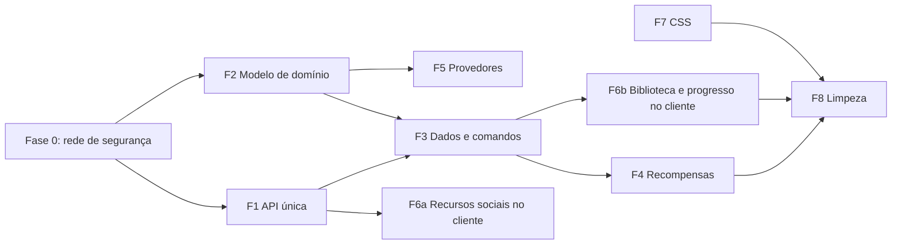

# Lume — plano de refatoração (01/11/2026)

> **Estado: revisão local de 03/11/2026; implementação e validação registradas ao final.** A responsável decidiu seguir com todas as frentes
> abaixo. Este documento descreve o destino da arquitetura e a ordem para chegar lá; ele não muda regras de
> produto. Pontuação continua em [Gamificação](GAMIFICACAO.md), lacunas de produto em
> [O que falta implementar](IMPLEMENTACAO.md) e importação em [Importação](IMPORTACAO.md). Ao concluir uma
> etapa, marque-a aqui e atualize os documentos indicados nela.

O Lume mudou de propósito várias vezes (organizador individual → plataforma social de estudos com XP validado,
ranking, mensagens, extensão e aplicativo de desktop). O código acompanhou por acréscimo: cada recurso novo
foi encaixado sobre a estrutura do protótipo. O resultado são oito frentes que pedem reestruturação, não só
reescrita, porque a forma atual encarece ou impede as próximas funcionalidades.

As seções **Diagnóstico** registram a situação de 01/11, não uma auditoria do código atual. Para o estado
vigente, consulte o registro de execução e as etapas marcadas. A revisão de F3 em 03/11 substitui integralmente
o desenho offline inicial. Publicação continua separada da implementação local.

---

## Sumário

| Frente | Problema central | Destrava (ver [Implementação](IMPLEMENTACAO.md)) | Tamanho | Depende de |
| --- | --- | --- | --- | --- |
| [F1 — API única](#f1--api-única-com-adaptadores) | Node e Worker repetem toda a camada HTTP | C2, C3, S2 e qualquer rota nova | M | — |
| [F2 — Modelo de domínio único](#f2--modelo-de-domínio-único) | Três registros de progresso e dois modelos de curso | B1, B3, G5 | G | — |
| [F3 — Dados no servidor e comandos](#f3--dados-normalizados-no-servidor-e-comandos) | O documento do navegador é a fonte da verdade, inclusive do XP | I6, C4, G1 | G | F1, F2 |
| [F4 — Motor de recompensas](#f4--motor-de-recompensas) | XP escrito à mão por tipo e empurrado pelo cliente | G2, G3, G4, G5, S5 | M | F3 |
| [F5 — Importação por provedor](#f5--importação-por-provedor) | Extração genérica; provedor é só rótulo | I1, I2, I6 | G | F2 (identidade) |
| [F6 — Cliente por funcionalidade](#f6--cliente-por-funcionalidade) | Um hook e um setter de estado inteiro para tudo | S1, V2 e telas novas | G | F6a: —; F6b: F3 |
| [F7 — CSS por componente](#f7--css-por-componente-sobre-tokens) | 125 KB em camadas sobrepostas e cinco folhas mortas | V1, D1, D4 | M | — |
| [F8 — Limpeza](#f8--limpeza-e-reescritas-pontuais) | Código legado, exportações mortas, documentos sobrepostos | D2, D3 | P | F2–F4 |

Tamanho é relativo (P, M, G), não estimativa de prazo.



---

## Princípios para todas as frentes

**Revisão final de escopo em 03/11/2026:** não há migração de dados. O modelo atual é v3,
com `units` no domínio, API e persistência. As propostas de conversão abaixo são históricas
e foram substituídas: formatos anteriores recebem erro explícito e permanecem no banco.
Isso não autoriza apagar dados. Cargos são títulos sem bloqueios; disciplina vale 200 XP e
conquista; tarefa vinculada conclui a aula, sem recompensa própria; sem vínculo, 0 XP.

1. **Preservar dados.** Nenhuma etapa apaga progresso, converte preparação em aula concluída ou recalcula XP já
   concedido. Toda conversão é uma função pura testada com estados reais anonimizados antes de rodar em conta.
   O documento antigo de cada conta fica guardado, só para leitura, até a responsável autorizar a remoção.
2. **Estrangulamento, não big bang.** Cada etapa termina com o site funcionando, `npm test`, `npm run build` e
   `npm run test:e2e` verdes. O código novo convive com o antigo atrás da mesma rota até a troca.
3. **Clientes antigos existem.** O service worker usa stale-while-revalidate: quem já visitou roda a versão
   anterior por uma visita, e a extensão publicada pode estar defasada. Rotas e formatos antigos continuam
   aceitos por pelo menos um ciclo, com resposta explícita quando não puderem mais ser atendidos.
4. **Migrações SQL só com número novo** (`0011_…` em diante). Nunca editar migração aplicada.
5. **Sem publicação implícita.** Nenhuma etapa inclui deploy, migração remota no D1 ou release do Companion
   sem pedido explícito, como manda o `AGENTS.md`.
6. **Documentação acompanha.** Cada etapa lista os documentos que precisa atualizar; a matriz de
   [Continuidade](CONTINUIDADE.md) e as lacunas de [Implementação](IMPLEMENTACAO.md) mudam junto com o código.

---

## Fase 0 — Rede de segurança

Antes de mexer em estrutura, fixar o comportamento atual para detectar regressões.

- [ ] **Fixtures de estado.** Reunir em `tests/fixtures/states/` documentos `lume.prototype.v1` com formato real
      e dados anonimizados: conta nova, conta com histórico legado (5/10 XP e preparações), curso importado com
      `structure`, curso com slides, tarefas com e sem vínculo, sessão ativa, exemplo sem progresso, backup antigo.
- [x] **Testes de contrato da API.** `api-contract.test.js`: famílias de rotas `/api/*`, status, formato do corpo
      e códigos de erro atuais, executados contra o servidor Node em processo. Servem de referência para F1 e F3.
- [x] **Testes de referência de XP.** `xp.test.js`, `progress.test.js` e `library-store.test.js` conferem
      chaves, valores, idempotência, tempo e rollback com dados sintéticos. Fixtures reais continuam pendentes.
- [x] Incluir os arquivos novos no script `test` do `package.json`.

**Pronto quando:** os três conjuntos rodam no CI e descrevem o comportamento atual sem alterá-lo.

---

## F1 — API única com adaptadores

### Diagnóstico

- `server.js` (905 linhas) e `worker.js` (799 linhas) reimplementam roteamento, cadastro, login, sessão,
  limite de tentativas, redefinição de senha, perfil de amigos, checagem de origem, leitura de corpo e
  conversão de erro. Só a lógica de domínio (`auth.js`, `xp.js`, `messages.js`…) é compartilhada.
- A conversão de erro é uma cadeia de dez `instanceof` repetida nos dois arquivos (`server.js:879`,
  `worker.js:757`), uma por classe de erro de módulo, quase todas idênticas (`XpError`, `MessagesError`,
  `FriendsError`…).
- Os dois já divergem em detalhes: o Worker declara `MAX_STATE_BYTES = 256 KB` sem usá-lo (o limite efetivo é o
  de 320 KB em `state.js`), os limites de tentativas por rota são diferentes (20 × 10 no Desktop e nos convites,
  30 × 10 na importação) e o envio de imagem de perfil sem conta é aceito só no Node.
- O perfil de amigos (`server.js:611`) monta SQL dentro do servidor, fora de um módulo compartilhado.
- Os e2e sobem `node server.js` (`playwright.config.js`) e os testes unitários usam `node:sqlite`. O Worker, que
  é o que está publicado, não é exercitado por nenhum teste.

### Arquitetura alvo

```
api/
  app.js              createApp({ db, media, email, env, clock, log }) → { fetch(request) }
  router.js           tabela de rotas: método, caminho, auth, origem, limite de corpo, handler
  errors.js           AppError(message, { code, status, field }) — substitui as classes por módulo
  http.js             json(), readJson(request, limit), readBytes(), cookies
  middleware/
    session.js        resolve a conta pelo cookie (hoje currentUser duplicado)
    origin.js         sameOrigin
    rate-limit.js     tentativas por chave, sobre o adaptador de banco
  routes/
    account.js        register, login, logout, me, password/*
    state.js  import.js  github.js  companion.js  friends.js  profile.js
    media.js  xp.js  messages.js  collaboration.js
  adapters/
    sqlite.js         node:sqlite → { run, first, all, batch }
    d1.js             D1 → { run, first, all, batch }
    node-http.js      IncomingMessage → Request; Response → ServerResponse
    fs-media.js       hoje localMediaBucket em server.js
    r2-media.js       hoje r2BucketAdapter em media.js
server.js             Node: abre o banco, aplica migrações, serve dist/, delega /api/* a app.fetch
worker.js             Cloudflare: ASSETS para estáticos, app.fetch para /api/*
```

Cada rota declara o que exige, em vez de repetir checagens:

```js
route('POST', '/api/xp/complete', { auth: true, origin: true, body: 8 * 1024 }, ({ user, body, db }) =>
  grantStep(db, user.id, body));
```

O adaptador ganha `batch(statements)`: D1 não tem transação interativa, então F3 e F4 dependem de gravar
vários comandos de uma vez. No Node, `batch` envolve as instruções em `BEGIN`/`COMMIT`.

### Etapas

1. [x] Criar `api/errors.js`, `api/http.js` e os adaptadores de banco (`companionDb()` em `server.js:421` e
       `dbAdapterFor()` no Worker viram `adapters/sqlite.js` e `adapters/d1.js`, com `batch`).
2. [x] Fazer os módulos de domínio lançarem `AppError` (ou subclasses que herdam dela) e trocar as duas cadeias
       de `instanceof` por um único tratamento em `app.js`.
3. [x] Mover as rotas de conta (cadastro, login, saída, recuperação) para `api/routes/account.js`, usando só o
       adaptador. Hoje o Node usa `prepare()` síncrono direto; passa a usar `db.first`/`db.run`.
4. [x] Mover as demais rotas, uma família por vez, conferindo os testes de contrato da Fase 0 a cada passo.
5. [x] Unificar constantes (limites de corpo, de estado, de tentativas) em `api/config.js`, lidas do `env`
       com os mesmos nomes nos dois ambientes. Manter os nomes antigos (`LUME_SHOW_RESET_LINK`,
       `LUME_ATTEMPT_LIMIT`) como apelidos por um ciclo e documentar a troca.
6. [x] Reduzir `worker.js` e `server.js` a adaptadores. Nenhuma regra de rota fica neles.
7. [x] Rodar os testes de contrato também contra o adaptador D1 (Miniflare, que já vem com o `wrangler`) para
       que o código publicado seja testado.

### Pronto quando

- `worker.js` e `server.js` não contêm nenhuma rota; uma rota nova é escrita uma vez.
- Há uma única classe de erro e um único conjunto de limites.
- Testes de contrato passam com SQLite e com D1; e2e verdes.

### Documentos

`AGENTS.md` (seção "A API existe duas vezes", armadilhas de configuração), [Release](RELEASE.md) se o CI ganhar
o passo com Miniflare.

---

## F2 — Modelo de domínio único

### Diagnóstico

- **Progresso em seis lugares:** `completed` (lista de ids), `history` (formato legado com 0, 5 ou 10 XP e
  entradas de preparação), `studyLog` (importação, integração e manual), `studySessions`, `tasks` (com XP próprio
  no navegador) e, no servidor, `xp_events`. `weekCount` soma três deles (`public/domain.js:511`).
- **Curso com dois modelos:** `steps` (lista plana) e `structure` (disciplina → módulo → aula). `steps` é derivado
  de `structure` na importação (`public/import-domain.js:355`) e os dois precisam ficar coerentes à mão.
- **Dois níveis:** o saldo legado (`levelInfo`, `totalXP`) ainda aparece em `Shell.jsx` e `Personal.jsx` ao lado
  do nível do servidor.
- **Validação tudo-ou-nada:** se um único curso, etapa ou entrada de histórico falhar, `restoreState`
  (`public/domain.js:660`) devolve o estado inicial vazio. O documento tem `version: 1` fixo e nenhuma migração
  de formato.

### Modelo alvo

| Entidade | Campos principais | Observações |
| --- | --- | --- |
| `Material` | `id`, `kind` (curso, leitura, projeto, aula avulsa, slides), `title`, `url`, `art`, `paused`, `planning`, `resume`, `source` | `source` guarda provedor, `externalId`, extração, capacidades e avisos (F5) |
| `Unit` | `id`, `materialId`, `parentId`, `kind` (disciplina, módulo, aula, etapa, slide), `title`, `order`, `externalId`, `url`, `duration`, `removedFromSource` | Árvore genérica: material criado à mão tem etapas na raiz; importado tem disciplina → módulo → aula |
| `ProgressEvent` | `id`, `unitId`, `materialId`, `type` (`completion`, `reversal`, `preparation`), `origin` (`manual`, `import`, `integration`, `legacy`), `historical`, `at` | Só cresce. Reverter é um evento novo, não apagar |
| `StudySession` | `id`, `materialId`, `unitId`, `startedAt`, `endedAt`, `pauses` | Declaração de tempo, nunca prova de atividade |
| `Task` | `id`, `title`, `unitId?`, `materialId?`, `dueDate`, `priority`, `subtasks`, `doneAt` | XP depende da decisão G4 |
| `Preferences` | tema, paleta, texto, meta semanal, compartilhamento, onboarding | Fica no documento de interface |

Tudo o mais é **derivado**: conjunto de unidades concluídas, progresso do material, contagem da semana, próxima
aula, saldo legado (só para exibição na prévia, enquanto existir).

### Regras de conversão do documento v1 → v2

- **Ids preservados.** O `id` de cada etapa vira o `id` da `Unit`. Isso mantém válidos `xp_events.step_id`, as
  chaves `event_key` já gravadas, os vínculos de tarefas e as referências em mensagens.
- `structure` vira a árvore; `steps` sem estrutura vira unidades `kind: 'etapa'` na raiz.
- `completed` + `history` + `studyLog` viram `ProgressEvent`:
  - entrada de `history` com `preparation: true` → `type: 'preparation'`, nunca `completion`;
  - entrada de `history` com XP 5 ou 10 → `origin: 'legacy'`, mantendo o valor antigo em `meta`;
  - entrada de `studyLog` com `origin: 'import'` → `historical: true`;
  - id em `completed` sem evento correspondente → `completion` com `origin: 'legacy'` e data desconhecida
    (não entra em nenhuma política nova).
- Item inválido é descartado **sozinho** e registrado em `conversionNotes`, nunca derruba o documento inteiro.
- O documento original do servidor é preservado em `user_state`. Por decisão de 03/11, os dados antigos
  do navegador são descartados; não há cópia persistida da prévia.

### Etapas

1. [ ] Criar `public/model/` com as entidades, as funções derivadas e os testes. Nada da interface muda ainda.
2. [ ] Escrever `convertV1toV2(state)` pura e testá-la com todas as fixtures da Fase 0, conferindo contagens
       (unidades, conclusões, preparações, XP legado) antes e depois.
3. [x] Escrever `restoreState` v2 com validação por item e um leitor v1 que converte na carga.
4. [x] Adaptar `backup-domain.js` e `merge-domain.js` para v2, mantendo a leitura de backups v1.
5. [x] Telas usam seletores de `material-model.js` e `progress-domain.js`; Biblioteca e diálogo usam
       `nextAction`, com o critério do roteiro. `nextMission` foi removido.
6. [x] `steps`/`structure` não são persistidos nas tabelas. Leituras dos registros v1 ficam na conversão.

**F2 implementada no contrato v3:** `public/material-model.js` define `units` com identidade,
pai, tipo, posição, seleção e metadados. Criação, edição, reimportação, backup, domínio e API
usam esse modelo único. Listas e árvores são derivadas e não coexistem no material.
Validação recusa ciclos, pais inválidos, tipos e ids duplicados. Leitura antiga não é convertida.
Slides continuam como extensão de apresentação, sem segunda lista de aulas.

### Pronto quando

- Existe um único registro de progresso e um único modelo de material; `steps` e `structure` deixaram de
  coexistir.
- Uma fixture com um item corrompido carrega todo o resto.
- Bônus por disciplina (G5) e desfazer progresso de material manual (B1) são implementáveis sem tocar em mais de
  um registro.

### Documentos

[Continuidade](CONTINUIDADE.md), [Gamificação](GAMIFICACAO.md) (onde fala do saldo legado), `AGENTS.md` (lista de
módulos de domínio).

---

## F3 — Dados normalizados no servidor e comandos

### Revisão aprovada em 03/11/2026

O pedido explícito substitui o desenho offline original: **API direta sobre D1, sem IndexedDB, fila offline,
cursor de sincronização ou reconciliação de documentos no navegador**. Dados de estudo só no navegador podem
ser descartados; documentos de contas existentes no servidor devem ser preservados e convertidos.

O commit `9d51520` inclui `0012_library.sql`, que separa `materials`, `units`, `study_progress`, `study_tasks`,
`study_sessions` e `account_documents`. `GET /api/library` carrega a conta; `POST /api/library/actions`
aplica operações por entidade com revisão e idempotência. Um conflito exige recarregar, sem mescla automática.
`user_state` permanece como arquivo após a conversão e recusa novas escritas. A prévia só dura nesta página.

Concorrência, falhas e repetição foram exercitadas no contrato Node/D1 e em testes de navegador. O XP de tempo
participa do mesmo batch, com teste de rollback. A persistência normalizada não conclui F2: `steps` e
`structure` ainda são projeções do contrato v2. A revisão confirmou o teto de 600 aulas no importador,
corpo de 3 MB e até 2000 ações por requisição, além da recusa das mutações legadas após conversão.
O desenho antigo de `/api/sync` e da fila está preservado apenas no histórico do Git.

### Diagnóstico

- Todo o progresso de uma conta é um JSON único em `user_state`, gravado pelo navegador inteiro a cada mudança
  (debounce de 900 ms em `useLume.js`; a sessão ativa toca o estado a cada 60 s em `Study.jsx:151`).
- **O XP não é validado de verdade pelo servidor.** `grantStep` (`xp.js:292`) confere `state.completed` e a data
  de conclusão lidas do documento que o próprio cliente escreveu. Quem altera o JSON obtém XP e sobe no ranking.
- XP (`xp.js:118`), colaboração (`collaboration.js:56`), desktop (`companion.js:168`) e perfil (`server.js:626`)
  relêem e interpretam o documento inteiro a cada requisição.
- O limite de 600 aulas e 320 KB (I6) é consequência direta desse formato.
- Conflitos entre dispositivos exigem mesclar o documento inteiro por heurística (`merge-domain.js`,
  `backup-domain.js`); o cliente tenta três vezes e desiste.

### Arquitetura vigente

O esquema executável está em `migrations/0012_library.sql`:

| Tabela | Responsabilidade |
| --- | --- |
| `materials` | Um registro por material, com ordem e metadados em `data` |
| `units` | Unidades por material, relação pai/filho, tipo, ordem, seleção e metadados |
| `study_progress` | Registro de progresso por conta, material e unidade |
| `study_tasks`, `study_sessions` | Tarefas e sessões, uma linha por entidade |
| `account_documents` | Preferências, onboarding, sessão ativa e revisão da biblioteca |
| `library_operations` | Identidade das operações já aplicadas |
| `library_write_guards` | Guarda que aborta todo o batch em conflito de revisão |

Os campos próprios de cada entidade ainda incluem JSON; não há documento único de estudo sendo substituído.
`public/material-model.js` separa os registros e monta as projeções `steps`/`structure` para compatibilidade.

```text
GET  /api/library
POST /api/library/actions { id, revision, actions }
  → biblioteca atual e revisão, ou 409 quando exige recarga
```

As operações são `material|task|session|progress.put|delete|order` e `account.update`, com validação de
progresso imutável e de referências. O servidor calcula recompensas; valores de XP não vêm do corpo enviado.
O mesmo id de operação não grava nem recompensa duas vezes. Escritas de unidades e coleções usam SQL em lote.

**Cliente.** As telas usam ações nomeadas por funcionalidade. As alterações otimistas existem somente em
memória; promessas serializam requisições em andamento. Falha bloqueia novas edições e permite repetir o id
da operação cujo resultado não foi confirmado. Conflito exige recarga e nova ação, sem mescla automática.
A prévia é descartada ao recarregar ou fechar a página. Não há IndexedDB, fila offline ou migração da prévia.

### Migração das contas existentes

- **Não executar migração de dados.** `/api/library` inicializa somente contas sem documento antigo.
- Documento antigo ou `account_documents` anterior ao v3 recebe `409 library_format_unsupported`.
- Nenhuma leitura apaga ou regrava esse documento. A biblioteca atual usa exclusivamente `units`.
- Mutações legadas sobre biblioteca nova continuam retornando `409 client_outdated`.
- Não houve migração remota nem publicação. `0013_titles.sql` apenas cria o esquema de títulos.

### Etapas

1. [x] Migração SQL das tabelas novas (`0012_library.sql`).
2. [x] Leitura e gravação por entidade em `library-store.js`/`library-actions.js`, testadas em SQLite e D1.
3. [x] Rotas `/api/library` e `/api/library/actions`, conversão preguiçosa, revisão e idempotência.
4. [x] Persistência direta; removidos armazenamento de estudo no navegador, fila e reconciliação.
5. [x] Perfil, desktop e colaboração leem `readStoredLibrary`, com fallback para contas ainda não convertidas.
6. [x] Interface usa a API nova; mutações legadas são recusadas depois da conversão.
7. [x] Exportação e restauração explícita de backup v2, mantendo leitura de v1.
8. [ ] Reavaliar os limites de I6 com o novo formato (limite por material, não por conta).

### Pronto quando

- Contas convertidas são lidas pelas tabelas; o caminho legado preserva contas ainda não convertidas.
- Editar o armazenamento local não concede XP: só uma operação aceita pelo servidor gera evento elegível.
- Importações não dependem do teto global de 320 KB. O contrato cobre 600 aulas; milhares ainda não são suportadas.
- e2e cobre resposta perdida e conflito explícito entre abas; o teste de conflito legado continua separado.

### Documentos

`AGENTS.md` (seção Estado), [Continuidade](CONTINUIDADE.md), [Implementação](IMPLEMENTACAO.md) (I6, C4, G1),
[Companheiro](COMPANHEIRO.md) se o formato de `/api/companion/study` mudar.

---

## F4 — Motor de recompensas

### Diagnóstico

- `xp.js` (720 linhas) tem uma função por tipo (`grantStep`, `grantBonus`, `grantSlide`, `recordTimeSession`) e
  conquistas calculadas por código específico (`achievementForStep`, `achievementForBonus`).
- O cliente encontra o que ainda não foi pontuado (`collectCompletionCandidates` em `xp-policy.js`), envia rota a
  rota e lembra o que já mandou em `localStorage` (`lume.xp.sent.v1`).
- Próximos itens — cargos e desbloqueios (G2), conquistas escolhidas (G3), XP de tarefas (G4), bônus de
  disciplina (G5), contribuição em colaboração (S5) — seriam mais funções e mais um laço no cliente.

### Arquitetura alvo

- Cada comando aceito em F3 gera **eventos de domínio** (`unit.completed`, `material.completed`,
  `discipline.completed`, `session.ended`, `task.completed`…).
- `rewards/rules.js` lista **regras declarativas**:

  ```js
  rule({
    id: 'lesson-completion',
    on: 'unit.completed',
    when: (ctx) => ctx.unit.kind === 'aula' && isEligible(ctx.material) && !ctx.event.historical,
    key: (ctx) => stepEventKey(kindFor(ctx.material), ctx.material.id, ctx.unit.id),
    xp: (ctx) => XP_VALUES[kindFor(ctx.material)],
    achievement: (ctx) => null,
  });
  ```

  Valores, tetos e marcos continuam em `public/xp-policy.js`.
- O motor roda **no servidor**, dentro do mesmo `batch` do comando, e grava em `xp_events` com o mesmo formato de
  `event_key` de hoje. Repetir o comando não duplica XP.
- Nível, conquistas, cargos e desbloqueios são **projeções** do livro: calculadas a partir de `xp_events` e
  `progress_events`, com tabela própria só quando precisam ser concedidas uma vez (`user_unlocks` para G2).
- O tempo declarado mantém o acumulador atual (`xp_time_sessions`), agora alimentado por `session.ended`.

### Etapas

1. [x] Extrair as regras atuais para o formato declarativo sem mudar comportamento; os testes dourados da Fase 0
       precisam continuar idênticos.
2. [x] Ligar o motor aos comandos de F3, no mesmo batch da biblioteca.
3. [x] Remover `collectCompletionCandidates` e `lume.xp.sent.v1`; o cliente atual não usa as rotas
       `/api/xp/complete|bonus|slides|time`. Elas ficam como compatibilidade de contas não convertidas.
4. [ ] Implementar as regras novas conforme as decisões da responsável: G5, G4, G2 (com `user_unlocks`), S5.
5. [ ] Retirar o saldo legado da exibição (ver decisões pendentes).

### Pronto quando

- Uma regra nova é uma entrada em `rules.js` com teste, sem rota nova e sem código no cliente.
- Testes dourados idênticos; teste de concorrência prova uma única concessão.

### Documentos

[Gamificação](GAMIFICACAO.md), `AGENTS.md` (seção XP validado no servidor), [Evolução](EVOLUCAO.md) §4.

---

## F5 — Importação por provedor

### Diagnóstico

Hoje a extração é **genérica**, e o provedor serve quase só como rótulo:

| Caminho | Onde | Como lê | Uso do provedor |
| --- | --- | --- | --- |
| Link público | `extractFromHtml`, `import-server.js:363` | schema.org; senão, títulos e listas filtrados por regex (`LESSON_LIKE`, `NAV_NOISE`, `ITEM_NOISE`) | Avisos para Gran, Estratégia e Udemy; tirar o nome do site do título |
| Página copiada | `analyzeSnapshot`/`snapshotOutline`, `import-server.js:657` | A mesma heurística, mais tolerante | Nenhum |
| Extensão | `run`, `extension/capture.js:639` | Varre o DOM procurando linhas com cara de aula | Nenhum, **exceto Gran**: `readGranApi` usa as rotas JSON da página e volta ao DOM se falhar |

Consequências:

- **Identidade por título.** O id de aula é hash de provedor, URL, disciplina, módulo e título
  (`normalizePayload`, `import-domain.js:192`). Renomear uma aula na plataforma cria outra aula e o progresso se
  perde na reimportação. O Gran entrega ids estáveis (`item.id`, `id_video`), que são descartados.
- **Conclusão adivinhada.** `completedTitlesFromHtml` e `isDone` procuram palavras como "concluído", "done" ou
  "100%" e classes como `completed`, depois comparam por título.
- **Capacidades fixas.** `providerCapabilities` (`import-domain.js:97`) responde "não acessa a conta" e "não
  consulta progresso" até para o Gran lido pela API, contrariando a regra de declarar capacidades reais.
- **Lista de plataformas em quatro lugares:** `PROVIDERS`, `PROVIDER_HOSTS` e `PLATFORM_NAME` (`capture.js`) e a
  lista de `tidyTitle`.
- **Sem teste por plataforma:** link testado com HTML sintético; extensão com páginas de exemplo.

### Princípio novo

**Cada provedor tem uma implementação própria**, responsável por ler a grade, dar identidade estável às
unidades e detectar conclusão. A leitura genérica deixa de ser o caminho padrão:

- Plataforma **conhecida com adaptador** → usa o adaptador.
- Plataforma **conhecida sem adaptador** → mensagem de "ainda não suportado" e oferta de texto colado; não tenta
  adivinhar.
- Plataforma **desconhecida** → provedor `generic` explícito, confiança baixa, **sem leitura de conclusão**.
- Texto colado e organização por IA continuam como provedor `text`.

### Contrato do adaptador

```js
// providers/grancursos.js
export default defineProvider({
  id: 'grancursos',
  label: 'Gran Cursos Online',
  hosts: ['grancursosonline.com.br'],
  art: 'nature',
  help: 'Abra o curso com a sua conta e use a extensão do Lume.',
  capabilities: {
    syllabus: 'full',           // full | partial | none
    progress: 'lesson-flags',   // none | lesson-flags | api
    resume: false,
    requiresLogin: true,
  },
  identify(url) {               // → { courseExternalId, canonicalUrl } ou null
    const code = /^\/aluno\/curso\/(?:video\/)?codigo\/([^/]+)/i.exec(url.pathname)?.[1];
    return code ? { courseExternalId: code, canonicalUrl: `${url.origin}/aluno/curso/codigo/${code}` } : null;
  },
  readers: {
    page: readFromLoggedPage,   // extensão, na página aberta com a conta (rotas JSON do Gran)
    // public: readFromPublicPage — servidor, só HTML público
    // snapshot: readFromCopiedHtml — página copiada pela pessoa
  },
});
```

Todo leitor devolve o mesmo formato: disciplinas → módulos → aulas, **cada nível com `externalId`**, mais
`completed` só quando o adaptador declara `progress` diferente de `none`. Utilitários comuns (busca com proteção
contra rede interna, `textOf`, `toSeconds`, limite de concorrência) ficam em `providers/kit/`, como ferramentas,
não como parser.

### Identidade estável e migração

- Unidade nova: `id = hash(provider | courseExternalId | unitExternalId)`.
- Unidade já importada (id por título): na primeira reimportação com adaptador, casar pelo caminho de títulos
  (disciplina, módulo, aula) e **gravar o `externalId` na unidade existente, mantendo o id antigo**. Progresso,
  XP e vínculos continuam intactos. O que não casar entra como novo e o antigo fica `removedFromSource`, como
  hoje.

### Onde cada leitor roda

- `page` roda na extensão; `public` e `snapshot`, no servidor (`/api/import/analyze`).
- **A extensão passa a ter build.** `capture.js` hoje é script clássico sem `import`; para compartilhar os
  adaptadores, `extension/src/` é empacotado (por exemplo, com esbuild) em `dist-extension/` pelo
  `scripts/package-extension.mjs` que já existe. Permissões do manifest não mudam (`activeTab`).
- O formato entregue ao Lume por `postMessage` continua aceito na versão antiga por um ciclo, porque a extensão
  publicada pode estar defasada.

### Ordem dos provedores

1. **Gran** — já tem leitura pela API conferida com conta real (01/11/2026, 31 disciplinas, 427 aulas).
2. **Coursera** e **Alura** — páginas públicas conferidas em 31/10.
3. **Udemy** — o servidor recebe 403; só pela extensão.
4. **Estratégia** — exige login; pela extensão.
5. **Rocketseat**, **DIO**, **Hotmart** — conforme demanda.

Cada provedor só é marcado como suportado com: fixture gravada de página real (anonimizada) em
`tests/fixtures/providers/<id>/`, teste do leitor contra ela, conferência manual datada em
[Importação](IMPORTACAO.md) e capacidades declaradas.

### Etapas

1. [x] Registro em `public/providers/registry.js` e utilitários em `kit.js`; lista derivada do registro.
2. [x] Adaptador do Gran extraído, com identidade externa entregue pela fonte (disciplina e aula).
3. [x] Fonte desconhecida sem conclusão e caminho de texto/IA. Recusa de plataformas conhecidas sem
       leitor próprio permanece decisão pendente; a heurística assistida existente não foi retirada.
4. [x] Build da extensão e remoção de `PROVIDER_HOSTS`/`PLATFORM_NAME` duplicados.
5. [x] `providerCapabilities` lê o adaptador; a revisão mostra as capacidades declaradas.
6. [x] Migração de identidade na reimportação, com teste usando curso importado por título.
7. [ ] Demais provedores, um por vez, na ordem acima.

### Pronto quando

- Nenhuma lista de domínios fora do registro.
- Reimportar um curso com aula renomeada preserva o progresso dela.
- Toda plataforma suportada tem teste com fixture real e capacidades corretas na interface.

### Documentos

[Importação](IMPORTACAO.md) (seções de plataformas e extensão), `extension/LEIAME.md`, `AGENTS.md` (seção
Extensão: "sem build" deixa de valer), [Implementação](IMPLEMENTACAO.md) I1, I2, I6.

---

## F6 — Cliente por funcionalidade

### Diagnóstico

- `useLume` (294 linhas) junta conta, prévia, sincronização, envio de XP e mesclagem.
- `App.jsx` entrega `state` e `update` (substitui o estado inteiro) a todas as telas (`App.jsx:111`); o
  conteúdo de três modais está numa única linha de 1.456 caracteres.
- Recursos do servidor são buscados tela a tela com `api()` e `setInterval` próprios (menu e Mensagens a cada
  45 s, Companion a cada 20 s), sem cache nem deduplicação.
- Rotas são um `switch` com leitura de parâmetros espalhada; `SectionTabs.jsx` repete a lista de telas.
- Componentes muito grandes: `Personal.jsx` e `ImportCourse.jsx` (31 KB cada), `Profile.jsx`, `StudyDialog.jsx`,
  `Study.jsx`, `Onboarding.jsx` (com 18 linhas acima de 300 caracteres).

### Arquitetura alvo

```
src/
  app/
    routes.js         tabela: hash, seção, componente, leitura de parâmetros; SectionTabs deriva daqui
    App.jsx           só casca, roteamento e modais registrados
  features/
    account/          sessão, prévia, entrada e saída
    library/          materiais, importação, editor, slides
    progress/         conclusões, sessão de estudo, histórico
    plan/             cronograma, tarefas, roteiro
    social/           amigos, perfil, mensagens, colaboração, ranking
    desktop/          Companion e atualização
    settings/
      (cada uma: actions.js | selectors.js | components/, conforme necessário)
  lib/
    api.js            cliente HTTP
    resources.js      cache de recursos do servidor com polling compartilhado
```

### Etapas

**F6a — independe de F2/F3, pode começar já:**

1. [x] Tabela de rotas e `SectionTabs` derivado dela.
2. [x] Camada de recursos com cache e polling compartilhado; migrar Amigos, Mensagens, Ranking, Colaboração,
       Companion e o contador de não lidas.
3. [x] Tirar os modais de `App.jsx` para componentes registrados.

**F6b — depois de F3:**

4. [x] Separar `useAccountSession` (conta e prévia), `useLibraryPersistence` (revisão, envio e repetição) e
       `useXp` (leitura do livro). `useLume` compõe os hooks e as ações nomeadas; não existe sincronização offline.
5. [x] Telas recebem ações nomeadas em vez de `update(previous => …)` ou `act`; importação, edição e restauração
       usam o estado mais recente. Bloqueios não limpam o formulário nem anunciam sucesso.
6. [x] Extrair responsabilidades: `StudySession`, `BackupPanel`, `OnboardingFields`, `LessonTree`,
       processamento de imagem em `profile-media.js` e página copiada em `clipboard-page.js`.
       As telas continuam compondo suas seções; extração não significa transformar cada trecho de JSX em arquivo.

### Pronto quando

- Nenhuma tela recebe `update` do estado inteiro.
- Cada recurso do servidor é buscado em um único lugar, com um único intervalo.
- Uma tela nova é uma pasta em `features/` e uma linha em `routes.js`.

### Documentos

`AGENTS.md` (seção SPA em uma única página Astro).

---

## F7 — CSS por componente sobre tokens

### Diagnóstico

- `public/lume.css` tem 125 KB e 6.111 linhas; as camadas novas (Plano, Redesign Moderno) sobrescrevem regras
  antigas no fim do arquivo.
- `entry.css`, `neurofocus.css`, `styles.css`, `stitch.css` e `motion.css` (cerca de 120 KB) não são carregados
  por nenhuma página e continuam publicados.
- Comentários com acentuação corrompida a partir de `lume.css:4400`.
- `@fontsource-variable/fraunces` está em `package.json` sem uso.
- O redesenho das oito telas restantes (V1) acrescentaria mais uma camada.

### Arquitetura alvo

```
src/styles/
  tokens.css        paletas (Azul, Roxo), temas e funções de cor — o topo atual de lume.css
  base.css          reset, tipografia, controles, utilitários
  shader.css        regras do Paper Shaders predeclaradas para a CSP (lume.css:234), sempre globais
src/features/<área>/*.css   regras da funcionalidade, importadas pelo manifesto global
```

O Vite gera nomes com hash, então o `?v=` manual em `index.astro` deixa de ser necessário. A CSP não muda:
folhas externas já são permitidas por `'self'`; `scripts/headers.mjs` continua cuidando só do inline.

### Etapas

1. [x] Remover as cinco folhas sem uso e a dependência `fraunces`; corrigir a codificação dos comentários.
2. [x] Extrair tokens, base e shader (`00-tokens.css`, `01-shader.css`, `02-base.css`).
3. [x] Mover 22 folhas para funcionalidades/casca e remover declarações sobrescritas no mesmo
       seletor/contexto. Ordem preservada em `src/styles/lume.css`; o redesenho V1 continua separado.
4. [x] Comparação de estilos com service worker bloqueado e fontes carregadas: 32 combinações de
       quatro rotas, dois tamanhos, duas paletas e dois temas, sem diferenças na limpeza inicial.
5. [x] Revisão de 08/11: seletores mortos removidos de `home.css`, `personal.css`, `shared-profile.css`,
       `shell.css` e `41-responsivo.css`; tarefas/subtarefas consolidadas em `plan/tasks.css`; cores fixas
       de overlay e medalhas trocadas por tokens.

### Pronto quando

- `lume.css` é só manifesto; regras por funcionalidade e tema. Estados, responsividade e seletores
  mais específicos continuam usando a cascata; não confundir essas sobreposições com declarações mortas.
- e2e de aparência (`appearance.spec.js`) verde nos quatro temas.

### Documentos

`AGENTS.md` (seção Cores e o aviso do `?v=`), [Implementação](IMPLEMENTACAO.md) V1, D1, D4.

---

## F8 — Limpeza e reescritas pontuais

Itens que não pedem nova arquitetura, só remoção ou reescrita, e ficam mais seguros depois das frentes acima.

- [x] D2 revisado: `nextMission` e `applyStudyRhythm` removidos; `weekCount` tem consumidores reais;
      `HABITS`/`CHALLENGES` validam campos de documentos antigos. Compatibilidade preservada.
- [x] Exportações sem consumidor (D3): `importXp`, `selectedCount`, `providerSummary`, `emptySessionState`,
      `GITHUB_CAPABILITIES`.
- [x] Mover os módulos de servidor da raiz (`auth.js`, `xp.js`, `messages.js`…) para `api/domain/` e os testes
      para `tests/unit/`, atualizando o script `test`.
- [x] Consolidar referências: Continuidade registra código existente e execução; Implementação é o
      registro de lacunas; Evolução preserva propostas e identifica explicitamente diagnósticos históricos.
      Relatos antigos de Continuidade ficam no Git; anexos históricos de Implementação não prevalecem.
- [x] Atualizar `AGENTS.md` com ações, hooks, modelo persistido e CSS por funcionalidade.

---

## Fases de execução

| Fase | Conteúdo | Pode correr em paralelo |
| --- | --- | --- |
| 0 | Rede de segurança (fixtures, contrato, dourados) | — |
| 1 | F1 completa; F7 etapa 1; F6a | F1, F7 e F6a tocam arquivos diferentes |
| 2 | F2 completa; F5 etapas 1–3 (registro, Gran, `generic`/`text`) | F5 só depende do campo `externalId` de F2 |
| 3 | F3 e F4 juntas; F5 etapas 4–6 | F5 não toca nas tabelas novas |
| 4 | F6b; F7 etapas 2–3 junto com V1; F5 etapa 7 | Por funcionalidade |
| 5 | F8 | — |

Ao fim de cada fase: `npm test`, `npm run build`, `npm run test:e2e`, revisão dos documentos indicados e
atualização deste plano.

---

## Riscos e mitigação

| Risco | Mitigação |
| --- | --- |
| Perda de progresso na conversão v1 → v2 | Função pura com fixtures reais; contagens antes/depois; documento v1 guardado; descarte por item com registro |
| XP em dobro após a migração | Manter o formato de `event_key`; testes dourados; idempotência por `command_id` |
| Conversão estoura a CPU do Worker gratuito | Medir com as maiores fixtures; conversão permanece no servidor |
| Cliente antigo grava formato velho | Resposta `client_outdated` para mutações depois da conversão |
| Extensão publicada defasada | Aceitar o formato antigo de captura por um ciclo |
| Regressão invisível no Worker | Testes de contrato também sobre D1 (F1 etapa 7) |
| Refatoração longa trava o produto | Fases entregam valor isolado; F6a, F7 e F5 avançam sem esperar F3 |

---

## Decisões pendentes da responsável

| Decisão | Bloqueia | Recomendação |
| --- | --- | --- |
| Tratamento de clientes antigos | Decidido e implementado | Recusar mutações com `client_outdated` depois da conversão |
| Persistência de estudo no navegador | Decidido em 03/11/2026 | Remover; API direta sobre D1 e prévia temporária em memória |
| Biblioteca de cache no cliente | Implementado | `src/lib/resources.js`, com revalidação e isolamento entre contas |
| Build da extensão | Implementado | esbuild, fonte em `extension/src/`, gerado versionado |
| Leitor `generic` lê ou não conclusão | Implementado | Não lê; conclusão só de adaptador que a declare |
| Plataforma conhecida sem adaptador: recusar ou tentar `generic` | F5 etapa 3 | Recusar e oferecer texto colado |
| Novo limite de unidades por material (substitui 600 aulas / 320 KB) | F3 etapa 8, I6 | Definir após medir com o curso grande do Gran |
| Retirar o saldo legado da prévia sem conta | F4 etapa 5 | Retirar; manter o histórico legado visível como registro, sem nível |
| Migração do XP das tarefas de prova (G4) | F4 etapa 4 | Já listada em [Implementação](IMPLEMENTACAO.md) |

---

## Registro de execução

### 03/11/2026 — F2 e política aprovada (continuação)

- Modelo único de materiais/unidades em domínio, transporte v3, persistência e backups.
- Conversão automática removida; formatos antigos recusados sem apagar bancos.
- Bônus de disciplina (200 XP + conquista) no batch de progresso, com seleção e grade completas.
- Tarefa vinculada registra a aula no cliente e no servidor; várias tarefas não repetem XP.
- Cargos aprovados como títulos: critérios em `title-policy.js`, concessões em `user_titles`,
  apresentação no perfil, preservação nas pausas e reavaliação após correções.
- Colaboração continua por convites; contribuição individual e recompensas ficam adiadas.
- Validação final desta continuação: `npm test` com 244 aprovados e 1 ignorado (mídia no Worker);
  após a limpeza do XP próprio de tarefas, 27 testes direcionados de domínio/tarefas aprovados.
  `npm run build` aprovado e suíte completa de interface sobre o build final com **108 testes
  aprovados**, desktop e mobile, um worker. Contrato inclui Node e D1 local; captura usa fixtures.
  Links locais da documentação e `git diff --check` verificados. Sem deploy ou migração remota.
  Os números das seções anteriores referem-se às respectivas rodadas históricas.

### 03/11/2026 — revisão do PR e persistência direta

**Commits de base:** `9d51520` registra persistência direta; `7236b08`, ações nomeadas, hooks de conta e
biblioteca, revalidação do cache e colaboração. A continuação remove `nextMission`, centraliza seletores,
extrai componentes, coloca o CSS junto das funcionalidades e consolida os documentos.

**Verificação final:** `npm test` com 236 aprovações e 1 cenário de mídia ignorado no Worker sem binding.
Inclui rejeição atômica de aulas inválidas/duplicadas e novos registros vinculados ao material errado,
preservando registros históricos inconsistentes. Suíte completa desktop/mobile: **106 aprovados**, incluindo
onboarding mobile e preservação de formulário durante bloqueio. Após a validação adicional da API e novo
build, **20 cenários direcionados aprovados** (backup, persistência, edição/slides e novo fluxo de perfil,
nos dois tamanhos). O perfil cobre processamento/upload da foto, apresentação, recarga e remoção.
`git diff --check` e 104 links locais/âncoras sem erro. As 29 folhas importadas não repetem declarações
no mesmo seletor/contexto; estilos calculados iguais nas 32 combinações verificadas.

- Corrigidas respostas de cache da conta anterior e perda de `externalId` na restauração/fallback da importação.
- Biblioteca normalizada com conversão transacional do documento do servidor, guarda de revisão e idempotência;
  uma escrita legada concorrente com a conversão é relida, não perdida. Ordenação dos materiais é preservada.
- Progresso, conquistas e tempo elegível gravados no mesmo batch. Falhas de concessão revertem também a edição;
  sessões esquecidas voltam pausadas, sobras de tempo acumulam e sobreposição não duplica minutos.
- SQL em lote para unidades/progresso/recompensas; contrato com 600 aulas passa em Node e D1 local.
- Testes de navegador passaram a criar contas e consultar a API em vez de injetar estado em localStorage;
  acrescentados cenários de resposta perdida, repetição idempotente, prévia temporária e conflito entre abas.
- A rodada anterior de navegador teve 105 aprovações e uma espera de gravação excedida no onboarding mobile.
  O trace confirmou respostas 200; a espera passou de 5 para 15 s e o XP só é relido no fim da sequência.
- Colaboração tem cenário de envio, aceite e cancelamento, sem copiar projeto ou conceder XP.
- Comparação de estilos calculados repetida após a relocação final: 32 combinações, nenhuma diferença
  depois de carregar as fontes. Isso não é aprovação visual de um redesenho novo.
- F2 ainda mantém projeção v2 no domínio e transporte; faltam fixtures reais anonimizadas de estados.
  F5 depende de fixtures das demais plataformas; aumento do limite de 600 aulas e CPU em produção continuam
  pendentes. Cargos, bônus de disciplina e migração do XP das tarefas são decisões de produto separadas.
- Trabalho local; sem push, deploy, migração remota ou release.

| Data | Etapa | O que foi entregue | Verificação |
| --- | --- | --- | --- |
| 01/11/2026 | Fase 0 | `api-contract.test.js` com o roteiro HTTP de todas as famílias de rota (`tests/contract/`). Os testes dourados de XP ficam em `xp.test.js`, que já cobre concessão, idempotência, bônus, tempo e ranking | `npm test` |
| 01/11/2026 | F1 completa | App único em `api/` (rotas declarativas, `AppError`, sessão, limites, adaptadores SQLite/D1/arquivos/node:http). `server.js` e `worker.js` viraram adaptadores. Comportamentos unificados: imagem de perfil sem conta só na prévia local; limites por rota iguais nos dois ambientes; variáveis com o mesmo nome; link de redefinição gerado a partir da origem da requisição. O contrato roda no Node e no Worker real (`wrangler dev --local`) | `npm test` (contrato nos dois alvos), `npm run build`, e2e desktop |
| 01/11/2026 | F7 etapa 1 | Removidas `entry.css`, `neurofocus.css`, `styles.css`, `stitch.css`, `motion.css` e a dependência `@fontsource-variable/fraunces`; acentos corrompidos de `lume.css` corrigidos | `npm run build` |
| 01/11/2026 | F6a | Tabela de rotas `src/app/routes.jsx` (abas, títulos e apelidos derivados), diálogos simples em `src/app/modals.jsx`, cache compartilhado `src/lib/resources.js` usado pelo contador de não lidas, Mensagens e Desktop (um intervalo por recurso; ler a conversa atualiza o contador na hora; o cache é limpo ao sair) | `npm run build`, e2e desktop |
| 01/11/2026 | F2 (progresso) | Registro único `state.progress` (`public/progress-domain.js`) no lugar de `completed`/`history`/`studyLog`; documento `version: 2` com conversão v1 → v2 que preserva o conjunto concluído, as preparações e o saldo legado (`legacyXp`); `restoreState` valida item a item (um curso ou registro estragado não zera o resto); cópia de segurança aceita v1 e v2; mesclagem entre dispositivos com "desfazer vence" e restauração com "conclusão vence"; `weekCount` deixou de contar preparação; `writeState` recusa gravação v1 sobre v2. **Ainda não feito no F2:** a árvore `Material`/`Unit` (cursos continuam com `steps` + `structure`) e `externalId` por unidade, que entram com o F5 | `npm test`, e2e desktop e celular |
| 01/11/2026 | F5 (etapas 1–6) | Registro `public/providers/` (um módulo por plataforma, `kit.js` com utilitários, `registry.js` como única lista de domínios); leitor `page` do Gran extraído da extensão, com `externalId` por disciplina e aula; capacidades da revisão vêm do provedor; fonte desconhecida não lê conclusão; ids de aula derivados do `externalId` e adoção dos ids antigos na reimportação; extensão com build (esbuild, `npm run extension:build`, `extension-build.test.js` confere o gerado; `src/` fora do pacote da loja). **Falta (etapa 7):** leitores próprios de Estratégia, Alura, Rocketseat, Udemy, Coursera, DIO e Hotmart, que exigem fixtures de páginas reais | `npm test`, e2e de captura e importação |
| 01/11/2026 | F3 (núcleo) e F4 | Migração `0011_progress_events.sql` (`progress_events`, `progress_accounts`); comandos `POST /api/progress` (`commands.js`) com `complete`, `prepare`, `revert` e `deck`; horário efetivo = menor entre o declarado e o do servidor; contas antigas em modo "documento" até o primeiro comando. Motor `rewards.js` com `RULES` declarativas (`unit-completion`, `material-completion`, `deck-completion`) e `runRules`; `xp.js` reduzido a livro, tempo, correção e ranking. Cliente com fila de saída (`src/lib/outbox.js`) no lugar do laço de candidatos. **Não feito no F3:** tabelas `materials`/`units`/`tasks` (a biblioteca continua no documento, que o servidor lê para validar a aula), endpoint de sincronização com cursor, armazenamento em IndexedDB e fim da mesclagem do documento; perfil, desktop e colaboração ainda leem o documento. **Não feito no F4:** regras novas G2 (cargos), G4 (tarefas) e G5 (disciplina), que dependem de decisão da responsável | `npm test` (inclui `progress.test.js` e contrato nos dois alvos), e2e desktop |
| 01/11/2026 | F8 (parte 1) | Removidas as exportações sem consumidor (D3) e `applyStudyRhythm` (substituído pelo onboarding), com seus testes; testes com banco usam `sqliteAdapter`/`applyMigrations` em vez de adaptadores copiados | `npm test` |
| 01/11/2026 | F7 (etapas 2 e parte da 3) | `public/lume.css` dividido em 29 arquivos por seção em `src/styles/` (tokens, shader, base, cada tela e as camadas finais), importados em ordem por `src/styles/lume.css` e empacotados pelo Astro antes do Atropos — mesma cascata, sem `?v=` manual. **Falta:** apagar as regras sobrescritas pelas camadas finais e co-localizar o CSS com cada componente, junto com o redesenho V1 de cada tela | `npm run build`, e2e desktop e celular, conferência visual da Biblioteca |
| 01/11/2026 | F6b (etapas 4–5, parcial) | Telas movidas para `src/features/<área>/` (account, library, progress, plan, social, settings, desktop), casca em `src/app/`, componentes visuais em `src/ui/`; `useLume` reduzido a estado, conta e sincronização, com XP em `features/progress/useXp.js`, envio de progresso em `features/progress/useProgressSync.js` e fotos antigas em `features/account/legacyProfileMedia.js`; nova ação `act(fn)` substitui todos os `update(result.state)` (conclusão de etapa e aula, desfazer, tarefa, sessão e apresentação), que podiam sobrescrever uma mudança concorrente. **Falta (etapa 6 e parte da 5):** quebrar os componentes grandes (`Personal.jsx`, `ImportCourse.jsx`, `Profile.jsx`, `StudyDialog.jsx`, `Onboarding.jsx`) e trocar os `update(previous => …)` restantes por ações nomeadas | `npm run build`, e2e desktop |
| 01/11/2026 | F8 (parte 2) | Módulos de servidor movidos para `api/domain/` e testes unitários para `tests/unit/` (imports, script `test` e documentos atualizados). **Falta:** consolidar `CONTINUIDADE.md`, `IMPLEMENTACAO.md` e `EVOLUCAO.md`, e remover `nextMission`, `HABITS` e `CHALLENGES` depois de unificar o critério de próxima aula com o roteiro (B4) | `npm test`, `npm run build`, e2e desktop |
